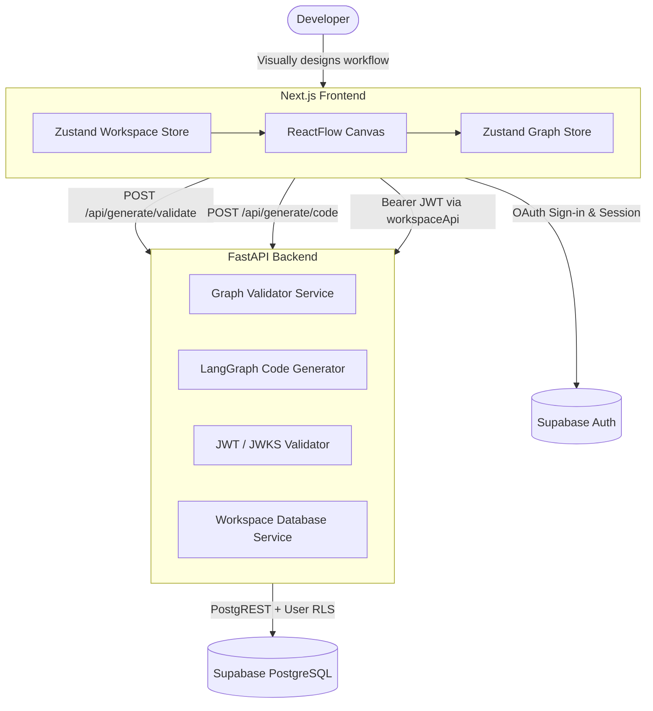

# Swarmly

> A visual IDE for designing multi-agent AI workflows and generating inspectable, production-ready LangGraph Python code.

---

## Overview

Designing multi-agent systems with frameworks like [LangGraph](https://github.com/langchain-ai/langgraph) often requires writing repetitive graph orchestration code, manual state passing, and complex conditional routing logic. Debugging syntax errors and circular references across agent nodes by hand can quickly slow down development.

**Swarmly** solves this by offering a developer-first visual IDE where engineers can:
1. Visually arrange, configure, and connect multi-agent systems using an interactive canvas.
2. Validate graph topology (cycles, missing entry points, disconnected nodes, routing conditions) in real time.
3. Automatically generate clean, idiomatic LangGraph Python code ready for inspection, clipboard copying, and direct download.

> **Note on Execution Model**: Swarmly generates inspectable LangGraph Python code for local deployment, CI/CD pipelines, and microservices. The backend generates and validates code; it does not execute arbitrary untrusted Python scripts on the server.

---

## Features

- **Visual Graph Canvas**: Built with ReactFlow for responsive drag-and-drop orchestration, fluid panning, and zooming.
- **Specialized Node Architecture**:
  - **LLM Agent Nodes**: Supports OpenAI, Anthropic, Google Gemini, and Ollama providers with configurable models, temperatures, and system prompts.
  - **Tool Nodes**: Native support for Tavily Search, Wikipedia, and extensible tool bindings using LangGraph `ToolNode` and `tools_condition`.
  - **Conditional Router Nodes**: Branching logic that routes state dynamically to downstream agents or finishes at `END`.
- **Real-Time Graph Validation**: Immediate syntax and structural checks covering entry points, unreachable nodes, duplicate edges, and router mapping integrity.
- **Idiomatic LangGraph Code Generator**: Produces clean Python scripts adhering to LangGraph `StateGraph`, `START`/`END` conventions, and environment-variable-backed API keys (`os.getenv`).
- **Syntax-Highlighted Code Inspector**: Built-in inspection drawer with one-click code copy and `.py` file export.
- **Starter Templates**:
  - *Research Agent*: Single agent with Tavily search tool integration.
  - *Research to Writer*: Multi-agent pipeline transferring research outputs to a drafting agent.
  - *Supervisor with Workers*: Central router/supervisor directing queries to specialized worker agents.
- **Guest Exploration Mode**: Fully functional local workflow design, validation, and Python code generation without requiring an account.
- **Cloud Persistence & Google OAuth**: Sign in with Google to save projects and multi-workflow workspaces backed by Supabase PostgreSQL with strict Row-Level Security (RLS).

---

## Architecture

Swarmly is architected as a decoupled full-stack application:



### Technology Stack

- **Frontend**: Next.js 16 (App Router), React 19, `@xyflow/react` (ReactFlow v12), Zustand v5, Tailwind CSS v4, Lucide React icons, React Syntax Highlighter.
- **Backend**: Python 3.10+, FastAPI, Pydantic v2, PyJWT, Cryptography, Uvicorn, HTTPX.
- **Database & Authentication**: Supabase PostgreSQL with PostgREST, Row-Level Security (RLS), Google OAuth, and asymmetric ES256 / symmetric HS256 JWT validation.

---

## Project Structure

```text
Swarmly/
├── .gitignore                      # Root Git ignore rules
├── README.md                       # Main repository documentation
├── codebase-analysis-docs/         # Architecture notes & design diagrams
└── MAIN/
    ├── frontend/                   # Next.js 16 Web Application
    │   ├── .env.example            # Template for frontend environment variables
    │   ├── package.json            # Frontend dependencies & npm scripts
    │   ├── tsconfig.json           # TypeScript configuration
    │   └── src/
    │       ├── app/                # App router (page, layout, auth callback)
    │       ├── components/         # Canvas, Toolbar, PropertiesPanel, Modals, Nodes
    │       ├── lib/                # API client, Supabase client, templates, nodeFactory
    │       ├── store/              # Zustand state stores (graph, workspace, auth, toast)
    │       └── types/              # TypeScript definitions for graph & workspace
    │
    └── backend/                    # FastAPI Microservice & LangGraph Compiler
        ├── .env.example            # Template for backend environment variables
        ├── main.py                 # FastAPI application entry point
        ├── requirements.txt        # Python package dependencies
        ├── src/
        │   ├── api/                # Route handlers (generate, projects, workflows, auth)
        │   ├── auth/               # JWT token verification (JWKS & HS256)
        │   ├── models/             # Pydantic schemas (graph, workspace)
        │   └── services/           # Code generator, graph validator, workspace DB
        ├── supabase/
        │   └── migrations/         # PostgreSQL DDL migrations & RLS policies
        └── tests/                  # Pytest test suite (compiler, auth, integration)
```

---

## Prerequisites

Before running Swarmly locally, ensure you have installed:
- **Node.js**: v18.17+ or v20+ / v22+
- **npm**: v9+ (or pnpm / yarn)
- **Python**: v3.10+ (tested on Python 3.13)
- **Supabase Account** *(Optional)*: Required only for cloud project saving and Google OAuth. Guest mode works completely offline without Supabase.

---

## Installation & Setup

### 1. Clone Repository

```bash
git clone <repository-url>
cd Swarmly
```

### 2. Configure Backend

1. Navigate to the backend directory:
   ```bash
   cd MAIN/backend
   ```
2. Create and activate a Python virtual environment:
   ```bash
   # Windows (PowerShell)
   python -m venv .venv
   .\.venv\Scripts\Activate.ps1

   # Linux / macOS
   python3 -m venv .venv
   source .venv/bin/activate
   ```
3. Install dependencies:
   ```bash
   pip install -r requirements.txt
   ```
4. Configure environment variables:
   ```bash
   cp .env.example .env
   ```
   *(Edit `.env` if connecting to a real Supabase instance. If using guest mode only, the default mock/auto settings work out of the box).*

### 3. Configure Frontend

1. In a separate terminal, navigate to the frontend directory:
   ```bash
   cd MAIN/frontend
   ```
2. Install dependencies:
   ```bash
   npm install
   ```
3. Configure environment variables:
   ```bash
   cp .env.example .env.local
   ```
   *(Update `.env.local` with your Supabase URL and anon key if using cloud features).*

---

## Environment Variables

### Frontend (`MAIN/frontend/.env.local`)

| Variable | Description | Required | Default |
| :--- | :--- | :---: | :--- |
| `NEXT_PUBLIC_API_URL` | Base URL of the FastAPI backend service | No | `http://localhost:8000` |
| `NEXT_PUBLIC_SUPABASE_URL` | Your Supabase project URL | Cloud Only | `""` |
| `NEXT_PUBLIC_SUPABASE_ANON_KEY` | Supabase public anonymous API key (safe for browser) | Cloud Only | `""` |

### Backend (`MAIN/backend/.env`)

| Variable | Description | Required | Default |
| :--- | :--- | :---: | :--- |
| `SUPABASE_URL` | Supabase project URL for PostgREST & JWKS endpoints | Cloud Only | `""` |
| `SUPABASE_ANON_KEY` | Supabase anon key used for backend requests | Cloud Only | `""` |
| `SUPABASE_JWT_SECRET` | Supabase JWT Secret for legacy symmetric HS256 tokens | Optional | `""` |
| `SUPABASE_MODE` | Operating mode: `auto`, `production`, or `test` | No | `auto` |

---

## Running Locally

Run both the backend and frontend in separate terminals:

### Start Backend (Port 8000)

```bash
cd MAIN/backend
# Ensure virtual environment is activated
uvicorn main:app --host 0.0.0.0 --port 8000 --reload
```

The FastAPI Swagger documentation will be available at: `http://localhost:8000/docs`

### Start Frontend (Port 3000)

```bash
cd MAIN/frontend
npm run dev
```

Open your browser to: `http://localhost:3000`

> **Troubleshooting Connection Issues**:
> - Verify the backend is listening on port 8000 by navigating to `http://localhost:8000/api/generate/validate` or checking `http://localhost:8000/docs`.
> - If Next.js cannot reach the backend, verify `NEXT_PUBLIC_API_URL` in `MAIN/frontend/.env.local` points to `http://localhost:8000`.

---

## Usage Guide

1. **Open Swarmly**: Navigate to `http://localhost:3000`. You can begin editing immediately in Guest Mode.
2. **Choose a Template or Blank Slate**: Click **Templates** in the toolbar to load a pre-configured architecture (e.g., *Supervisor with Workers*) or build from scratch.
3. **Add Nodes**: Drag agent, tool, or router nodes from the bottom-left palette onto the canvas.
4. **Configure Agents**: Click on any node to open the **Properties Panel** on the right. Configure LLM provider (OpenAI, Anthropic, Gemini, Ollama), model names, temperatures, and custom system instructions.
5. **Connect Nodes**: Connect output handles to target input handles. Connect agents to tools and routers to construct your state graph.
6. **Validate Graph**: Click **Validate** in the top toolbar to verify graph topology. Any orphaned nodes, loops, or missing transitions are flagged.
7. **Generate Python**: Click **Generate Python** to compile the visual graph into LangGraph code.
8. **Inspect & Export**: Review the generated Python script in the modal, copy it to your clipboard, or click **Download .py**.
9. **Cloud Workspace (Optional)**: Click **Sign in** with Google to create cloud projects, manage multiple workflows, and retain workspace persistence across devices.

---

## Testing & Quality Assurance

### Backend Automated Tests

Run the full pytest suite from `MAIN/backend`:

```bash
cd MAIN/backend
python -m pytest tests/ -v
```

The backend test suite covers:
- **Compiler & Generator**: Validates Python syntax, START/END constants, conditional edges, tools condition bindings, and provider initializations.
- **JWT & JWKS Authentication**: Tests token expiration, invalid signatures, unknown kid claims, and ES256 live JWKS resolution.
- **Supabase Integration & RLS**: Verifies project and workflow CRUD operations and multi-user data isolation under PostgreSQL Row-Level Security.

### Frontend TypeScript & Build Verification

Run TypeScript compilation checks and the production build:

```bash
cd MAIN/frontend

# Type check
npx tsc --noEmit

# Production build
npm run build
```

---

## Security Notes

1. **Environment Secrets**: Never commit `.env` or `.env.local` files to Git. Both are excluded by the root `.gitignore`.
2. **Supabase Service-Role Key**: Never expose `service_role` keys in client-side code or public repositories. Swarmly utilizes the public `anon` key alongside user Bearer JWTs and Row-Level Security (RLS) policies.
3. **JWT Verification**: Cloud API endpoints authenticate requests using asymmetric ES256 keys fetched directly from Supabase JWKS or configured JWT secrets.
4. **Generated Code Execution**: Generated Python scripts use `os.getenv("PROVIDER_API_KEY")` rather than embedding credentials. Always inspect and run generated scripts within an isolated environment.

---

## Current Limitations

- **Code Execution**: Swarmly is an IDE for workflow design, validation, and LangGraph code generation; it does not execute live agent loops on the backend server.
- **Custom Python Tool Functions**: Tool nodes currently generate standard function definitions and LangChain bindings; custom arbitrary Python execution within the visual editor is not supported.

---

## Contributing

1. Fork the repository and create a feature branch:
   ```bash
   git checkout -b feature/my-feature
   ```
2. Make your focused modifications.
3. Ensure all tests and builds pass:
   ```bash
   # Backend
   cd MAIN/backend && pytest tests/
   # Frontend
   cd MAIN/frontend && npx tsc --noEmit && npm run build
   ```
4. Commit your changes with clear, descriptive commit messages.
5. Open a Pull Request for review.

---

## License

Licensing terms for this project are to be determined by the repository owner.
