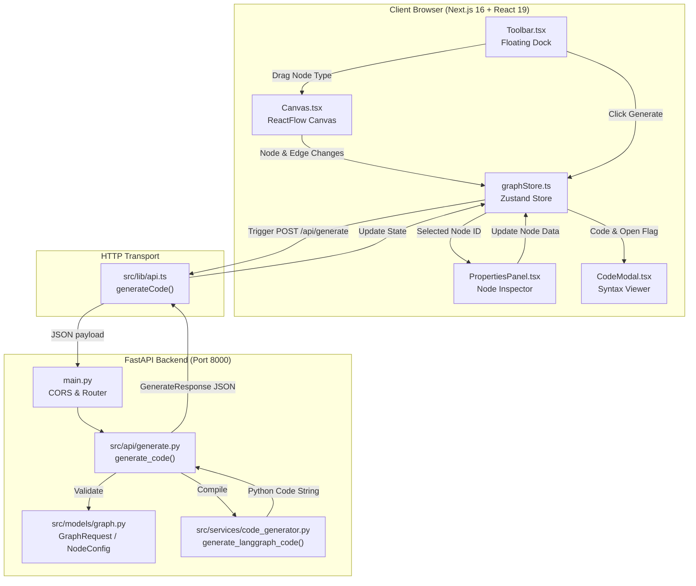
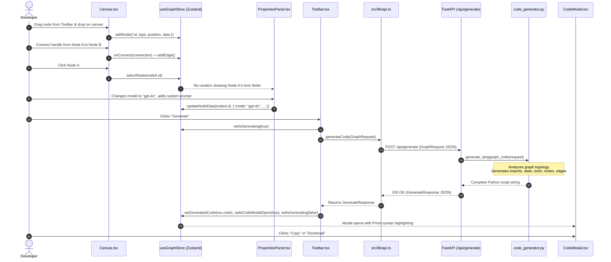
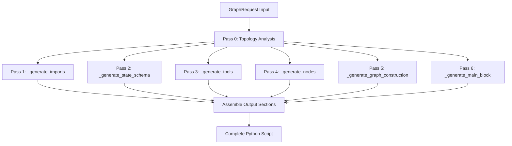

# Swarmly Codebase Knowledge Base & Architectural Reference

> **Document Version**: 1.0.0  
> **Master Location**: `codebase-analysis-docs/CODEBASE_KNOWLEDGE.md`  
> **Repository Target**: `MAIN/` (`MAIN/backend`, `MAIN/frontend`)  
> **Audience**: Autonomous AI Agents, Senior Software Architects, Full-Stack Engineers  
> **Purpose**: Standalone, exhaustive knowledge repository enabling safe feature additions, bug fixes, refactoring, and mental-model reconstruction without needing to index the raw codebase.

---

## Table of Contents
1. [Phase 1 – Initial Context Scan & Executive Overview](#1-phase-1--initial-context-scan--executive-overview)
   - [1.1 Purpose, Domain & Target Users](#11-purpose-domain--target-users)
   - [1.2 Technology Stack & Dependency Inventory](#12-technology-stack--dependency-inventory)
   - [1.3 Repository Directory Topology](#13-repository-directory-topology)
   - [1.4 High-Level Feature Ecosystem](#14-high-level-feature-ecosystem)
2. [Phase 2 – System Architecture Deep Dive](#2-phase-2--system-architecture-deep-dive)
   - [2.1 Architectural Paradigm](#21-architectural-paradigm)
   - [2.2 Component Interaction & Topology Map](#22-component-interaction--topology-map)
   - [2.3 End-to-End Data Flow](#23-end-to-end-data-flow)
   - [2.4 Cross-Cutting Concerns](#24-cross-cutting-concerns)
3. [Phase 3 – Feature-by-Feature Technical Breakdown](#3-phase-3--feature-by-feature-technical-breakdown)
   - [3.1 Canvas & Visual Graph Construction](#31-canvas--visual-graph-construction)
   - [3.2 Multi-Provider LLM Agent Nodes](#32-multi-provider-llm-agent-nodes)
   - [3.3 Tool Nodes & LangChain Tool Calling](#33-tool-nodes--langchain-tool-calling)
   - [3.4 Router Nodes & Conditional State Branching](#34-router-nodes--conditional-state-branching)
   - [3.5 Properties Configuration Panel (Inspector)](#35-properties-configuration-panel-inspector)
   - [3.6 Code Generation Compiler Pipeline](#36-code-generation-compiler-pipeline)
   - [3.7 Code Modal, Syntax Highlighting & Export](#37-code-modal-syntax-highlighting--export)
   - [3.8 Floating Excalidraw UI vs. Legacy UI Components](#38-floating-excalidraw-ui-vs-legacy-ui-components)
4. [Phase 4 – Nuances, Subtleties & "Things You Must Know Before Changing Code"](#4-phase-4--nuances-subtleties--things-you-must-know-before-changing-code)
   - [4.1 The Router Virtualization Quirk](#41-the-router-virtualization-quirk)
   - [4.2 Identifier Sanitization & `_safe_id`](#42-identifier-sanitization--_safe_id)
   - [4.3 Entrypoint Heuristic Resolution](#43-entrypoint-heuristic-resolution)
   - [4.4 LangGraph State Reducer Semantics (`operator.add`)](#44-langgraph-state-reducer-semantics-operatoradd)
   - [4.5 Frontend Tool Declarations vs. Backend Compiler Stubs](#45-frontend-tool-declarations-vs-backend-compiler-stubs)
   - [4.6 Pure Function Architecture & Absence of Persistence](#46-pure-function-architecture--absence-of-persistence)
   - [4.7 Drag-and-Drop Coordinate Space Normalization](#47-drag-and-drop-coordinate-space-normalization)
5. [Phase 5 – Technical Reference, Schemas & Glossary](#5-phase-5--technical-reference-schemas--glossary)
   - [5.1 REST API Specification](#51-rest-api-specification)
   - [5.2 Data Contracts: TypeScript Interfaces vs. Pydantic Models](#52-data-contracts-typescript-interfaces-vs-pydantic-models)
   - [5.3 Code Generator Multi-Pass Compiler Structure](#53-code-generator-multi-pass-compiler-structure)
   - [5.4 Domain Glossary](#54-domain-glossary)
6. [Phase 6 – Developer Guides & Extension Playbooks](#6-phase-6--developer-guides--extension-playbooks)
   - [6.1 How to Add a New LLM Provider](#61-how-to-add-a-new-llm-provider)
   - [6.2 How to Add a New Built-In Tool](#62-how-to-add-a-new-built-in-tool)
   - [6.3 How to Add a New Node Type (End-to-End)](#63-how-to-add-a-new-node-type-end-to-end)
   - [6.4 Local Development Runbook](#64-local-development-runbook)
7. [Appendix: Large-Codebase Chunking Controller & State Block](#7-appendix-large-codebase-chunking-controller--state-block)

---

## 1. Phase 1 – Initial Context Scan & Executive Overview

### 1.1 Purpose, Domain & Target Users
**Swarmly** is a developer-centric, low-code visual IDE for designing, wiring, and generating **multi-agent AI workflows** built on Python's **LangGraph** and **LangChain** frameworks.

- **Domain**: Agentic AI engineering, workflow orchestration, code synthesis.
- **Problem Solved**: Hand-coding LangGraph state graphs (`StateGraph`), typed message state accumulators (`TypedDict` with `operator.add`), dynamic routing functions, conditional edges, and LLM tool attachments is verbose, boilerplate-heavy, and prone to routing errors.
- **Target Users**: AI engineers, Python developers, solution architects, and prompt engineers who want to assemble complex multi-agent reasoning chains visually and instantly export clean, idiomatic, fully-executable Python code.
- **Core Value Proposition**: "Visual composition without lock-in." Swarmly does not execute arbitrary untrusted code on a cloud server; instead, it compiles the visual graph into standard Python script that users inspect, copy, and run in their own local environments.

### 1.2 Technology Stack & Dependency Inventory

#### Backend (`MAIN/backend`)
- **Runtime**: Python 3.12+ / 3.13
- **Web Framework**: FastAPI (`fastapi`, `uvicorn[standard]`)
- **Validation & Serialization**: Pydantic v2 (`pydantic`)
- **Environment**: `python-dotenv`
- **Target Frameworks (Compiled Outputs)**:
  - `langchain`, `langgraph`
  - `langchain-openai`, `langchain-anthropic`, `langchain-google-genai`, `langchain-ollama`, `langchain-community`
  - `tavily-python`

#### Frontend (`MAIN/frontend`)
- **Framework**: Next.js 16.3.8 (App Router, React 19.2.8)
- **Styling**: Tailwind CSS v4 (`@tailwindcss/postcss`, `tailwindcss@4`), PostCSS, custom CSS custom properties (variables)
- **Canvas Engine**: ReactFlow v12 (`@xyflow/react` v12.12.0)
- **State Management**: Zustand v5 (`zustand` v5.0.15)
- **Syntax Highlighting**: `react-syntax-highlighter` (Prism vscDarkPlus theme)
- **Iconography**: `lucide-react`
- **Primitives**: Radix UI (`@radix-ui/react-dialog`, `@radix-ui/react-select`, `@radix-ui/react-label`, `@radix-ui/react-separator`)
- **Utility Libraries**: `clsx`, `tailwind-merge`, `class-variance-authority`

### 1.3 Repository Directory Topology

The active repository root is located at `d:\Program_FIles\Swarmly`. Note: As documented in `agenda.md`, the `MAIN` directory contains the production codebase; sibling directories (such as `multi-agent-software-team`) are inactive references.

```
d:\Program_FIles\Swarmly\
├── agenda.md                              # Working notes specifying MAIN as the canonical version
├── codebase-analysis-docs/                # Master documentation root
│   ├── CODEBASE_KNOWLEDGE.md             # This document
│   └── assets/                           # Mermaid architecture and pipeline diagrams
│       ├── system_architecture.mmd
│       ├── compiler_pipeline.mmd
│       └── data_flow.mmd
└── MAIN/                                 # Active application root
    ├── README.md                          # Root pointer
    ├── backend/                          # FastAPI REST API & Code Compiler
    │   ├── .env                           # Backend environment variables
    │   ├── ARCHITECTURE.md                # Backend design decisions & LangGraph generation rules
    │   ├── main.py                        # FastAPI entry point, CORS config, health check
    │   ├── requirements.txt               # Backend Python dependencies
    │   └── src/
    │       ├── __init__.py
    │       ├── api/
    │       │   ├── __init__.py
    │       │   └── generate.py            # Route handler for POST /api/generate
    │       ├── models/
    │       │   ├── __init__.py
    │       │   └── graph.py               # Pydantic schemas (NodeConfig, EdgeConfig, GraphRequest)
    │       └── services/
    │           ├── __init__.py
    │           └── code_generator.py      # Core code generation compiler engine (~350 LOC)
    └── frontend/                         # Next.js 16 / React 19 Client Application
        ├── package.json                   # Dependencies and scripts
        ├── tsconfig.json                  # TypeScript compiler settings
        ├── next.config.ts                 # Next.js configuration
        ├── ARCHITECTURE.md                # Frontend design decisions & UX notes
        ├── AGENTS.md                      # Next.js agent build notes
        ├── public/                        # Static assets (SVGs)
        └── src/
            ├── app/
            │   ├── layout.tsx             # Root HTML layout with Geist font loading
            │   ├── page.tsx               # Primary page mount (Excalidraw floating canvas layout)
            │   └── globals.css            # Dark theme tokens, ReactFlow overrides, custom form classes
            ├── components/
            │   ├── Canvas.tsx             # Fullscreen ReactFlow canvas & drag-and-drop listener
            │   ├── Toolbar.tsx            # Floating top dock with draggable nodes & Generate button
            │   ├── PropertiesPanel.tsx    # Floating left-side property editor for active node
            │   ├── CodeModal.tsx          # Floating modal displaying generated Python script
            │   ├── Header.tsx             # Legacy top navbar (retained for backward reference)
            │   ├── NodePalette.tsx        # Legacy left sidebar palette (retained)
            │   ├── ConfigPanel.tsx        # Legacy right slide-out panel (retained)
            │   └── nodes/
            │       ├── AgentNode.tsx      # Custom node UI: LLM Agent (Indigo accent #7c6af7)
            │       ├── ToolNode.tsx       # Custom node UI: Tool (Emerald accent #3ecf8e)
            │       └── RouterNode.tsx     # Custom node UI: Router (Amber accent #f59e0b)
            ├── lib/
            │   ├── api.ts                 # Fetch client calling POST /api/generate
            │   └── utils.ts               # clsx + twMerge utility
            ├── store/
            │   └── graphStore.ts          # Zustand store managing nodes, edges, selection, code
            └── types/
                └── graph.ts               # Shared TypeScript interfaces mirroring backend models
```

### 1.4 High-Level Feature Ecosystem

```
┌─────────────────────────────────────────────────────────────────────────────────────────┐
│                                    SWARMLY WORKSPACE                                    │
└─────────────────────────────────────────────────────────────────────────────────────────┘
          │                                           │                          │
          ▼                                           ▼                          ▼
 ┌───────────────────┐                      ┌───────────────────┐      ┌───────────────────┐
 │ 1. Visual Canvas  │                      │ 2. Node Config    │      │ 3. Code Compiler  │
 │ - ReactFlow v12   │◄────────────────────►│ - PropertiesPanel │─────►│ - FastAPI Backend │
 │ - Infinite Grid   │                      │ - Multi-Provider  │      │ - Multi-pass AST/ │
 │ - Custom Nodes    │                      │ - Tool Bindings   │      │   string compiler │
 │ - Drag & Drop     │                      │ - Routing Rules   │      │ - Python Script   │
 └───────────────────┘                      └───────────────────┘      └───────────────────┘
          │                                                                      │
          └──────────────────────────────────────────────────────────────────────┤
                                                                                 ▼
                                                                       ┌───────────────────┐
                                                                       │ 4. Code Preview   │
                                                                       │ - Prism Highlight │
                                                                       │ - Copy to Board   │
                                                                       │ - Download .py    │
                                                                       └───────────────────┘
```

1. **Visual Canvas Composition**: Pan, zoom, drag nodes from the toolbar dock onto an infinite dot-grid, link nodes with directed handles, delete, select, and reposition.
2. **Node Specialization**:
   - **LLM Agent**: Configures provider (OpenAI, Anthropic, Google, Ollama), model name, API key, system prompt, and sampling temperature.
   - **Tool**: Selects built-in capability (Tavily Search, Wikipedia, Calculator, Python REPL) and optional tool API key.
   - **Router**: Configures condition rules matching text keywords in the previous message (`last_content`) and defines target node branches or `END`.
3. **Automated Compiler Pipeline**: Compiles the visual graph structure into idiomatic LangGraph Python code including:
   - Deduplicated imports
   - Type-safe `AgentState` schema using `Annotated[list[BaseMessage], operator.add]`
   - Tool instantiations and binding to agent nodes
   - Node functions processing message arrays and invoking models
   - Graph compilation with conditional edges and entry point auto-discovery
   - Executable `__main__` entry point test block

---

## 2. Phase 2 – System Architecture Deep Dive

### 2.1 Architectural Paradigm

Swarmly is designed as an **Asynchronous Pure-Compiler Client-Server Architecture**:

1. **State Ownership**:
   - The frontend (`MAIN/frontend/src/store/graphStore.ts`) is the single source of truth for all canvas nodes, node positions, connectivity edges, and node properties.
   - The backend (`MAIN/backend`) has **no database, no persistent session, and no cache**. It is a pure idempotent compiler function: `f(GraphRequest) -> GenerateResponse`.
2. **Excalidraw UX Layout Pattern**:
   - The root page (`MAIN/frontend/src/app/page.tsx`) renders the ReactFlow canvas as a full-viewport ground layer (`position: fixed, inset: 0, z-index: 0`).
   - All interactive controls float on top with specific z-indices:
     - `Toolbar` (`z-index: 100`, top-center floating dock)
     - `PropertiesPanel` (`z-index: 90`, left-center floating property card)
     - `CodeModal` (`z-index: 200`, backdrop and modal overlay)
3. **Execution Model**:
   - Swarmly does **not** evaluate code in a server-side sandbox. It is an **authoring and compilation tool**, intentionally shielding backend infrastructure from untrusted code execution risks while empowering users to run generated scripts locally.

### 2.2 Component Interaction & Topology Map



### 2.3 End-to-End Data Flow



### 2.4 Cross-Cutting Concerns

| Concern | Implementation Mechanism | Notes & Security Implications |
|---|---|---|
| **CORS Policy** | `fastapi.middleware.cors.CORSMiddleware` in `MAIN/backend/main.py` | Set to `allow_origins=["*"]` for local dev. **Production Requirement**: Must be restricted to trusted origins. |
| **Input Validation** | Pydantic v2 models in `MAIN/backend/src/models/graph.py` | Strict parsing of `NodeType`, `LLMProvider`, and `ToolName` enums. Returns standard `422 Unprocessable Entity` on schema errors. |
| **API Keys & Secrets** | Passed directly in `NodeConfig` payload | Keys entered by users in the UI are embedded into the generated code string for execution. Keys are never saved to a database or logged on the backend. |
| **State Synchrony** | Single Zustand store in `MAIN/frontend/src/store/graphStore.ts` | Eliminates prop-drilling. Uses ReactFlow's `applyNodeChanges` and `applyEdgeChanges` for performant canvas manipulation without full DOM re-renders. |
| **CSS Tokenization** | Custom CSS variables in `MAIN/frontend/src/app/globals.css` | Uniform dark palette across floating panels, inputs, handles, and canvas background. |

---

## 3. Phase 3 – Feature-by-Feature Technical Breakdown

### 3.1 Canvas & Visual Graph Construction
- **Location**: `MAIN/frontend/src/components/Canvas.tsx`
- **Business Need**: Give users an intuitive, drag-and-drop spatial environment to conceptualize agent architecture.
- **Technical Implementation**:
  - Employs `@xyflow/react` (ReactFlow v12) inside `ReactFlowProvider`.
  - Registered custom node types:
    ```typescript
    const nodeTypes = {
      llm_agent: AgentNode,
      tool: ToolNode,
      router: RouterNode,
    };
    ```
  - Grid configuration: Dot background (`gap={24}`, `size={1}`, color `#2e2e38`), snap-to-grid enabled `[8, 8]`, zoom clamped between `0.2` and `2.5`.
  - Deletion listeners: Bound to `Delete` and `Backspace` keys.
  - Position resolution: Uses `screenToFlowPosition({ x: e.clientX, y: e.clientY })` to convert client screen pixels into ReactFlow canvas coordinate space during drag-and-drop.
  - Node naming: Uses an internal ref `counters` (`llm_agent: 0`, `tool: 0`, `router: 0`) to automatically label nodes upon creation (e.g., "LLM Agent 1", "Tool 1").

### 3.2 Multi-Provider LLM Agent Nodes
- **Location**: `MAIN/frontend/src/components/nodes/AgentNode.tsx`, `MAIN/backend/src/services/code_generator.py`
- **Business Need**: Enable flexible integration of models across different commercial and local providers without syntax differences.
- **Supported Providers**:
  - `openai`: Instantiates `ChatOpenAI(model=..., api_key=..., temperature=...)`
  - `anthropic`: Instantiates `ChatAnthropic(model=..., api_key=..., temperature=...)`
  - `google`: Instantiates `ChatGoogleGenerativeAI(model=..., api_key=..., temperature=...)`
  - `ollama`: Instantiates `ChatOllama(model=..., temperature=...)` (no API key required)
- **Node Component Features**:
  - Indigo left accent (`#7c6af7`), dark card background (`#222228`).
  - Top handle (`Position.Top`) for incoming message flow, bottom handle (`Position.Bottom`) for outgoing message flow.
  - Badges displaying selected provider and model name.
  - Dynamic glow when selected (`boxShadow: 0 0 0 2px #7c6af730...`).

### 3.3 Tool Nodes & LangChain Tool Calling
- **Location**: `MAIN/frontend/src/components/nodes/ToolNode.tsx`, `MAIN/backend/src/services/code_generator.py`
- **Business Need**: Allow agents to call real-world search engines, APIs, and computation tools.
- **Supported Tools**:
  - `tavily_search`: Uses `TavilySearchResults(api_key=..., max_results=3)` from `langchain_community.tools.tavily_search`.
  - `wikipedia`: Uses `WikipediaQueryRun(api_wrapper=WikipediaAPIWrapper())` from `langchain_community.tools.wikipedia`.
  - `calculator` & `python_repl`: Defined via stub `@tool` functions.
- **Node Wiring & Tool Binding Mechanics**:
  - When an edge connects an LLM Agent node to a Tool node (`LLM -> Tool`), the code generator recognizes the relationship.
  - The LLM node function binds the tool:
    ```python
    llm_with_tools = llm.bind_tools([tool_var])
    response = llm_with_tools.invoke([SystemMessage(...)] + state["messages"])
    ```
  - The Tool node is added to the graph as a LangGraph prebuilt `ToolNode`:
    ```python
    graph.add_node("tool_1", ToolNode([tool_var]))
    ```

### 3.4 Router Nodes & Conditional State Branching
- **Location**: `MAIN/frontend/src/components/nodes/RouterNode.tsx`, `MAIN/backend/src/services/code_generator.py`
- **Business Need**: Enable non-linear agent behaviors: loopbacks, conditional task delegation, and criteria-based termination.
- **Technical Operation**:
  - The node UI displays an amber accent (`#f59e0b`) and a condition count badge.
  - Conditions are stored as an array of `{ keyword: string, targetNodeId: string }`.
  - In `PropertiesPanel`, users can add multiple rules ("if message contains `[keyword]` route to `[Node or END]`").
  - In the code generator, the router is **compiled into a routing function**:
    ```python
    def router_1_router(state: AgentState) -> str:
        messages = state.get("messages", [])
        last_content = messages[-1].content if messages else ""
        if "DONE" in last_content:
            return "END"
        return "END"
    ```
  - Conditional edges are attached to the **upstream node** that connects to the router:
    ```python
    graph.add_conditional_edges("llm_node_1", router_1_router, {"END": END, ...})
    ```

### 3.5 Properties Configuration Panel (Inspector)
- **Location**: `MAIN/frontend/src/components/PropertiesPanel.tsx`
- **Business Need**: Provide an in-context editor to configure the selected node without navigating away from the canvas.
- **Design Decisions**:
  - Floats on the left viewport edge (`left: 14, top: 50%, transform: translateY(-50%)`, width 268px).
  - Appears with a smooth fade-and-slide animation (`.panel-enter`) when a node is selected; renders `null` when no node is selected.
  - Editable inline node label header with colored dot reflecting the node's type accent.
  - Dedicated form sections:
    - **LLM**: Provider select dropdown, model text input with provider-specific placeholders, masked secret API key input with show/hide toggle, system prompt multiline textarea, and temperature slider (`0.00` to `1.00`, step `0.05`).
    - **Tool**: Tool selection dropdown, conditional Tavily API key input.
    - **Router**: Dynamic list of keyword routing rules with delete icons, keyword inputs, target node select dropdowns, and an "Add condition" button.

### 3.6 Code Generation Compiler Pipeline
- **Location**: `MAIN/backend/src/services/code_generator.py`
- **Function**: `generate_langgraph_code(request: GraphRequest) -> str`
- **Business Need**: Produce readable, runnable, lint-free Python code without external runtime dependencies during code creation.
- **Compilation Architecture**: Multi-pass generation strategy:
  1. **Pass 0 (Topology Analysis)**: Traverses nodes and edges to build maps:
     - `used_providers`: Set of active LLM providers.
     - `used_tools`: Set of active tools.
     - `node_in_edges`: Dict mapping each target ID to list of source IDs.
     - `node_out_edges`: Dict mapping each source ID to list of target IDs.
     - `llm_to_tools`: Maps each LLM node to its connected tool nodes.
  2. **Pass 1 (Imports Collection - `_generate_imports`)**: Emits deduplicated imports from `langgraph.graph`, `langchain_core.messages`, provider libraries, and tool libraries.
  3. **Pass 2 (State Schema - `_generate_state_schema`)**: Emits the standard `AgentState(TypedDict)` containing `messages: Annotated[list[BaseMessage], operator.add]`.
  4. **Pass 3 (Tools Instantiation - `_generate_tools`)**: Instantiates tool objects (`TavilySearchResults`, `WikipediaQueryRun`, or custom `@tool` functions) with variable names `tool_{safe_id}`.
  5. **Pass 4 (Node Functions - `_generate_nodes`)**: Emits Python functions for LLM nodes (`{safe_id}_node(state: AgentState)`) and router nodes (`{safe_id}_router(state: AgentState)`).
  6. **Pass 5 (Graph Assembly - `_generate_graph_construction`)**:
     - Instantiates `StateGraph(AgentState)`
     - Registers LLM and Tool nodes via `graph.add_node()`
     - Resolves graph entry point via `graph.set_entry_point()`
     - Emits static edges via `graph.add_edge()` (skipping router sources and START edges)
     - Emits dynamic edges via `graph.add_conditional_edges()` linking router functions
     - Compiles graph via `graph.compile()`
  7. **Pass 6 (Entry Point Invocation - `_generate_main_block`)**: Appends an executable `if __name__ == "__main__":` block with an initial `HumanMessage` invoke and message loop printout.

### 3.7 Code Modal, Syntax Highlighting & Export
- **Location**: `MAIN/frontend/src/components/CodeModal.tsx`
- **Business Need**: Give users immediate visibility into the compiled Python script with one-click export capabilities.
- **Technical Operation**:
  - Modal sheet with blurred backdrop (`background: rgba(0,0,0,0.72), backdropFilter: blur(4px)`).
  - macOS-style decorative traffic light header displaying file name (e.g., `my_agent.py`) and line count badge.
  - Code rendered using `react-syntax-highlighter` Prism engine with `vscDarkPlus` theme.
  - Actions:
    - **Copy to Clipboard**: Uses `navigator.clipboard.writeText()` with 2-second checkmark feedback.
    - **Download .py**: Creates a dynamic `Blob` with `text/plain`, generates an Object URL, triggers an anchor download, and revokes the URL.

### 3.8 Floating Excalidraw UI vs. Legacy UI Components
In the codebase, two layout paradigms exist:

| Component | Status | Layout Model | File Path |
|---|---|---|---|
| `Toolbar.tsx` | **Active** | Floating top dock (`z-index: 100`) | `MAIN/frontend/src/components/Toolbar.tsx` |
| `PropertiesPanel.tsx` | **Active** | Floating left card (`z-index: 90`) | `MAIN/frontend/src/components/PropertiesPanel.tsx` |
| `Header.tsx` | Legacy | Static fixed top bar | `MAIN/frontend/src/components/Header.tsx` |
| `NodePalette.tsx` | Legacy | Static left sidebar (`w-[220px]`) | `MAIN/frontend/src/components/NodePalette.tsx` |
| `ConfigPanel.tsx` | Legacy | Slide-out right sidebar (`w-80`) | `MAIN/frontend/src/components/ConfigPanel.tsx` |

The root page (`MAIN/frontend/src/app/page.tsx`) exclusively mounts the floating components (`Canvas`, `Toolbar`, `PropertiesPanel`, `CodeModal`). The legacy components are preserved in the repository as reference implementations for a 3-column dashboard layout.

---

## 4. Phase 4 – Nuances, Subtleties & "Things You Must Know Before Changing Code"

### 4.1 The Router Virtualization Quirk
In the visual canvas, a **Router** is represented as an independent node with handles, appearing identical to an LLM or Tool node.
However, in the compiled LangGraph Python code:
- **Routers are NEVER added to `graph.add_node()`**.
- A Router node does not execute as an independent graph step.
- Instead, the compiler scans `node_in_edges` to find which nodes connect *into* the router. It then calls `graph.add_conditional_edges()` on those **parent nodes**, using the router's generated `{router_id}_router` function as the routing condition.
- Any edge in the visual canvas where `edge.source == router_id` is intentionally skipped during normal edge addition (`graph.add_edge`).

> **Critical Rule**: If modifying the Router node or edge generation logic, remember that in LangGraph, conditional routing is an edge property, not a node execution unit.

### 4.2 Identifier Sanitization & `_safe_id`
ReactFlow creates node IDs using UUIDs or timestamp strings with hyphens (e.g., `"llm_agent-1741362810000"` or `"node-1"`).
Python identifiers cannot contain hyphens and cannot begin with numeric digits:
```python
def _safe_id(node_id: str) -> str:
    """Convert a ReactFlow node ID into a valid Python identifier."""
    safe = re.sub(r"\W|^(?=\d)", "_", node_id)
    return safe
```
- Non-alphanumeric characters (`\W`, like `-`) are replaced with `_`.
- Leading digits (`^(?=\d)`) have an underscore prepended (e.g., `"123"` becomes `"_123"`).
- All function names (`{safe_id}_node`), router functions (`{safe_id}_router`), and graph node names use this sanitized string.

### 4.3 Entrypoint Heuristic Resolution
LangGraph requires a designated entry node via `graph.set_entry_point(node_name)`. The compiler resolves the entry point using a 3-tier fallback hierarchy:
1. **Explicit START Edge**: If an edge has `edge.source == "START"`, the target of that edge becomes the entry point.
2. **In-Degree Zero Node**: If no explicit START edge exists, the compiler searches for a node that has **no incoming edges** (`node.id not in node_in_edges`) and is **not a Tool node** (`node.type != NodeType.TOOL`).
3. **First Node Fallback**: If all nodes have incoming edges (such as in a cyclic graph), the compiler defaults to the first node in the array (`nodes[0].id`).

### 4.4 LangGraph State Reducer Semantics (`operator.add`)
The generated state schema is strictly:
```python
class AgentState(TypedDict):
    messages: Annotated[list[BaseMessage], operator.add]
```
The `Annotated[..., operator.add]` reducer informs LangGraph to **append** message lists rather than overwrite them when a node returns `{"messages": [response]}`. Without this reducer, parallel node branches or cyclic loops would overwrite state history.

### 4.5 Frontend Tool Declarations vs. Backend Compiler Stubs
In the frontend `Toolbar.tsx` and `PropertiesPanel.tsx`, four tools are listed:
- `tavily_search`
- `wikipedia`
- `calculator`
- `python_repl`

In the backend `code_generator.py`:
- `tavily_search` imports and creates real `TavilySearchResults`.
- `wikipedia` imports and creates real `WikipediaQueryRun` and `WikipediaAPIWrapper`.
- `calculator` and `python_repl` generate placeholder `@tool` stub functions:
  ```python
  @tool
  def tool_calc_1(query: str) -> str:
      """Placeholder for calculator"""
      return "Result"
  ```
> **Actionable Takeaway**: When implementing production calculator or REPL capabilities, implement corresponding LangChain community imports in `_generate_imports` and `_generate_tools`.

### 4.6 Pure Function Architecture & Absence of Persistence
There is currently no database in `MAIN/backend`. The frontend does not persist graphs across page refreshes (no `localStorage` or remote database sync). Reloading the browser resets the canvas to an empty state.
- **Architectural Intent**: Keep Phase 1 lightweight and stateless.
- **Future Implication**: When introducing agent persistence (saving, loading, templates), add a PostgreSQL/SQLite database to the backend and expose `GET /api/agents`, `POST /api/agents`, `GET /api/agents/{id}`.

### 4.7 Drag-and-Drop Coordinate Space Normalization
When dropping a node from `Toolbar.tsx` into `Canvas.tsx`:
- The client event provides screen-relative pixels (`e.clientX`, `e.clientY`).
- Because the canvas supports panning and zooming, these coordinates do not match canvas flow space.
- The canvas must use ReactFlow's hook `const { screenToFlowPosition } = useReactFlow();` to project screen pixels into the current canvas zoom and offset coordinates. Failure to use this hook causes nodes to appear offset when the canvas is zoomed or panned.

---

## 5. Phase 5 – Technical Reference, Schemas & Glossary

### 5.1 REST API Specification

#### Health Check
- **Method**: `GET /`
- **Description**: Verifies service status.
- **Response**:
  ```json
  {
    "status": "ok",
    "service": "Swarmly API"
  }
  ```

#### Generate LangGraph Code
- **Method**: `POST /api/generate`
- **Request Headers**: `Content-Type: application/json`
- **Request Body (`GraphRequest`)**:
  ```json
  {
    "agent_name": "ResearchAssistant",
    "nodes": [
      {
        "id": "agent_1",
        "type": "llm_agent",
        "label": "Researcher",
        "provider": "openai",
        "model": "gpt-4o",
        "api_key": "sk-proj-...",
        "system_prompt": "You are a research agent.",
        "temperature": 0.5
      },
      {
        "id": "tool_1",
        "type": "tool",
        "label": "Search Web",
        "tool_name": "tavily_search",
        "tool_api_key": "tvly-..."
      }
    ],
    "edges": [
      {
        "source": "agent_1",
        "target": "tool_1"
      }
    ]
  }
  ```
- **Response (`GenerateResponse`)**:
  ```json
  {
    "code": "\"\"\"Generated by Swarmly for Agent: ResearchAssistant\"\"\"\n\nimport operator...",
    "agent_name": "ResearchAssistant",
    "node_count": 2,
    "edge_count": 1
  }
  ```

### 5.2 Data Contracts: TypeScript Interfaces vs. Pydantic Models

| TypeScript Interface (`src/types/graph.ts`) | Pydantic Model (`src/models/graph.py`) | Fields & Types |
|---|---|---|
| `NodeType` | `NodeType(str, Enum)` | `'llm_agent'`, `'tool'`, `'router'` |
| `LLMProvider` | `LLMProvider(str, Enum)` | `'openai'`, `'anthropic'`, `'google'`, `'ollama'` |
| `ToolName` | `ToolName(str, Enum)` | `'tavily_search'`, `'wikipedia'`, `'calculator'`, `'python_repl'` |
| `RouterCondition` | `RouterCondition(BaseModel)` | `keyword: str`, `target_node_id: str`, `default_target_id: Optional[str]` |
| `NodeData` | `NodeConfig(BaseModel)` | `id: str`, `type: NodeType`, `label: str`, `provider?: LLMProvider`, `model?: str`, `api_key?: str`, `system_prompt?: str`, `temperature?: float`, `tool_name?: ToolName`, `tool_api_key?: str`, `conditions?: list[RouterCondition]` |
| `GenerateRequest['edges']` | `EdgeConfig(BaseModel)` | `source: str`, `target: str`, `label?: Optional[str]` |
| `GenerateRequest` | `GraphRequest(BaseModel)` | `agent_name: str`, `nodes: list[NodeConfig]`, `edges: list[EdgeConfig]` |
| `GenerateResponse` | `GenerateResponse(BaseModel)` | `code: str`, `agent_name: str`, `node_count: int`, `edge_count: int` |

### 5.3 Code Generator Multi-Pass Compiler Structure

Located in `MAIN/backend/src/services/code_generator.py`:



### 5.4 Domain Glossary

- **StateGraph**: The primary graph structure in LangGraph representing a stateful computational graph parameterized by an agent state type.
- **AgentState**: A `TypedDict` schema passed between nodes in LangGraph that stores conversation history and execution context.
- **Reducer**: A merge function specified in `Annotated[Type, reducer]` (specifically `operator.add`) instructing LangGraph how to combine updates from multiple nodes into a single state key.
- **ToolNode**: A prebuilt LangGraph node (`from langgraph.prebuilt import ToolNode`) that automatically executes tool calls emitted by an LLM.
- **Conditional Edge**: A dynamic graph edge in LangGraph whose destination is evaluated at runtime by a routing function inspecting the current state.
- **Excalidraw Layout Pattern**: A visual design paradigm where the canvas occupies the entire viewport as a ground layer and all tools, inspectors, and modals float as lightweight cards on top.
- **Node In-Degree**: The count of directed edges pointing into a node; used by the compiler to detect entry point nodes (in-degree = 0).

---

## 6. Phase 6 – Developer Guides & Extension Playbooks

### 6.1 How to Add a New LLM Provider
To add support for a new LLM provider (e.g., Mistral, Groq, or AWS Bedrock):

1. **Update Frontend Types**:
   - In `MAIN/frontend/src/types/graph.ts`, append the provider to `LLMProvider`:
     ```typescript
     export type LLMProvider = 'openai' | 'anthropic' | 'google' | 'ollama' | 'groq';
     ```
2. **Update Properties Panel UI**:
   - In `MAIN/frontend/src/components/PropertiesPanel.tsx`, add an `<option>` to the Provider select:
     ```tsx
     <option value="groq">Groq</option>
     ```
   - In `MODEL_PLACEHOLDER`, add the default model name (e.g., `groq: 'llama-3.3-70b-versatile'`).
3. **Update Backend Models**:
   - In `MAIN/backend/src/models/graph.py`, add the enum member to `LLMProvider`:
     ```python
     class LLMProvider(str, Enum):
         ...
         GROQ = "groq"
     ```
4. **Update Code Generator**:
   - In `MAIN/backend/src/services/code_generator.py`:
     - Update `_generate_imports`:
       ```python
       if LLMProvider.GROQ in used_providers:
           imports.append("from langchain_groq import ChatGroq")
       ```
     - Update `_generate_nodes`:
       ```python
       elif node.provider == LLMProvider.GROQ:
           llm_init = f'ChatGroq(model="{model}", api_key="{api_key}", temperature={temp})'
       ```
5. **Update Backend Dependencies**:
   - Add `langchain-groq` to `MAIN/backend/requirements.txt`.

### 6.2 How to Add a New Built-In Tool
To add a new built-in tool (e.g., Arxiv search or DuckDuckGo):

1. **Update Frontend Types**:
   - In `MAIN/frontend/src/types/graph.ts`, append the tool name to `ToolName`.
2. **Update Frontend UI**:
   - In `MAIN/frontend/src/components/PropertiesPanel.tsx`, add `<option>` to the Tool select and add API key inputs if required.
   - In `MAIN/frontend/src/components/nodes/ToolNode.tsx`, add the label to `TOOL_LABELS`.
3. **Update Backend Models**:
   - In `MAIN/backend/src/models/graph.py`, add the tool to `ToolName(str, Enum)`.
4. **Update Code Generator**:
   - In `code_generator.py`, add required imports to `_generate_imports` and instantiation logic to `_generate_tools`.

### 6.3 How to Add a New Node Type (End-to-End)
To add a new node type (e.g., `HUMAN_IN_THE_LOOP` or `EVALUATOR`):

1. **Declare Type**:
   - Add to `NodeType` in `MAIN/frontend/src/types/graph.ts` and `MAIN/backend/src/models/graph.py`.
2. **Create Visual Node Component**:
   - Create `MAIN/frontend/src/components/nodes/EvaluatorNode.tsx` using `@xyflow/react` handles and custom styling.
   - Register it in `nodeTypes` in `MAIN/frontend/src/components/Canvas.tsx`.
3. **Add to Toolbar**:
   - In `MAIN/frontend/src/components/Toolbar.tsx`, add the tool descriptor to `NODE_TOOLS`.
4. **Add Form in Properties Panel**:
   - In `MAIN/frontend/src/components/PropertiesPanel.tsx`, add configuration fields for the new node type.
5. **Add Code Generation Logic**:
   - In `MAIN/backend/src/services/code_generator.py`, handle the new node in `_generate_nodes` and `_generate_graph_construction`.

### 6.4 Local Development Runbook

#### 1. Backend Setup
```bash
# Navigate to backend directory
cd MAIN/backend

# Create virtual environment (optional but recommended)
python -m venv .venv
# Activate:
# Windows PowerShell: .venv\Scripts\Activate.ps1
# Linux/macOS: source .venv/bin/activate

# Install dependencies
pip install -r requirements.txt

# Run FastAPI dev server (port 8000)
python main.py
# Server starts at http://localhost:8000 (Swagger docs at http://localhost:8000/docs)
```

#### 2. Frontend Setup
```bash
# Navigate to frontend directory
cd MAIN/frontend

# Install node dependencies
npm install

# Run Next.js development server (port 3000)
npm run dev
# Web application available at http://localhost:3000
```

---

## 7. Appendix: Large-Codebase Chunking Controller & State Block

### A. State Block

```yaml
STATE_BLOCK:
  INDEX_VERSION: 1.0.0
  LAST_UPDATED: 2026-10-07T23:22:00+05:30
  WORKSPACE_ROOT: "d:/Program_FIles/Swarmly"
  CANONICAL_SOURCE: "MAIN"
  
  FILE_MAP_SUMMARY:
    - PATH: "MAIN/backend/main.py"
      TYPE: "FastAPI Entry Point"
      LINES: 28
      STATUS: "Fully Analyzed"
    - PATH: "MAIN/backend/src/models/graph.py"
      TYPE: "Pydantic Schemas"
      LINES: 68
      STATUS: "Fully Analyzed"
    - PATH: "MAIN/backend/src/api/generate.py"
      TYPE: "Route Handler"
      LINES: 20
      STATUS: "Fully Analyzed"
    - PATH: "MAIN/backend/src/services/code_generator.py"
      TYPE: "Compiler Engine"
      LINES: 310
      STATUS: "Fully Analyzed"
    - PATH: "MAIN/frontend/src/app/page.tsx"
      TYPE: "Root View (Excalidraw Layout)"
      LINES: 35
      STATUS: "Fully Analyzed"
    - PATH: "MAIN/frontend/src/components/Canvas.tsx"
      TYPE: "ReactFlow Canvas"
      LINES: 120
      STATUS: "Fully Analyzed"
    - PATH: "MAIN/frontend/src/components/Toolbar.tsx"
      TYPE: "Floating Top Dock"
      LINES: 220
      STATUS: "Fully Analyzed"
    - PATH: "MAIN/frontend/src/components/PropertiesPanel.tsx"
      TYPE: "Floating Property Inspector"
      LINES: 430
      STATUS: "Fully Analyzed"
    - PATH: "MAIN/frontend/src/components/CodeModal.tsx"
      TYPE: "Code Preview Sheet"
      LINES: 180
      STATUS: "Fully Analyzed"
    - PATH: "MAIN/frontend/src/store/graphStore.ts"
      TYPE: "Zustand State Store"
      LINES: 75
      STATUS: "Fully Analyzed"
    - PATH: "MAIN/frontend/src/types/graph.ts"
      TYPE: "TypeScript Definitions"
      LINES: 35
      STATUS: "Fully Analyzed"
    - PATH: "MAIN/frontend/src/components/nodes/AgentNode.tsx"
      TYPE: "Custom ReactFlow Node"
      LINES: 90
      STATUS: "Fully Analyzed"
    - PATH: "MAIN/frontend/src/components/nodes/ToolNode.tsx"
      TYPE: "Custom ReactFlow Node"
      LINES: 80
      STATUS: "Fully Analyzed"
    - PATH: "MAIN/frontend/src/components/nodes/RouterNode.tsx"
      TYPE: "Custom ReactFlow Node"
      LINES: 75
      STATUS: "Fully Analyzed"

  OPEN_QUESTIONS:
    - QUESTION: "When will backend agent persistence (Phase 2) be introduced?"
      CONTEXT: "Currently, graphs are kept entirely in memory on the frontend."
    - QUESTION: "Should Calculator and Python REPL be upgraded from stub functions to real community tool wrappers?"
      CONTEXT: "Backend currently generates placeholder @tool stubs for these two tools."

  KNOWN_RISKS:
    - RISK: "Client API Keys in Payload"
      SEVERITY: "Medium"
      MITIGATION: "API keys are transmitted to /api/generate over HTTP. In production, ensure HTTPS is enforced and consider moving keys to environment variables or secret vaults."
    - RISK: "CORS Open Wildcard"
      SEVERITY: "Low (Dev) / High (Prod)"
      MITIGATION: "main.py currently has allow_origins=['*']. Restrict to the frontend production origin before deployment."

  GLOSSARY_DELTA:
    - "Excalidraw Layout": Full-screen canvas ground layer with independent z-indexed floating overlays.
    - "Router Virtualization": Pattern where a visual node is compiled into conditional edge attachments rather than an independent StateGraph node.
    - "safe_id": Regex sanitizer replacing non-alphanumeric characters with underscores for Python identifier compliance.
```

---
*End of Master Codebase Knowledge Document.*
